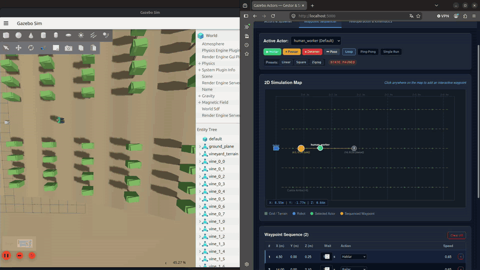
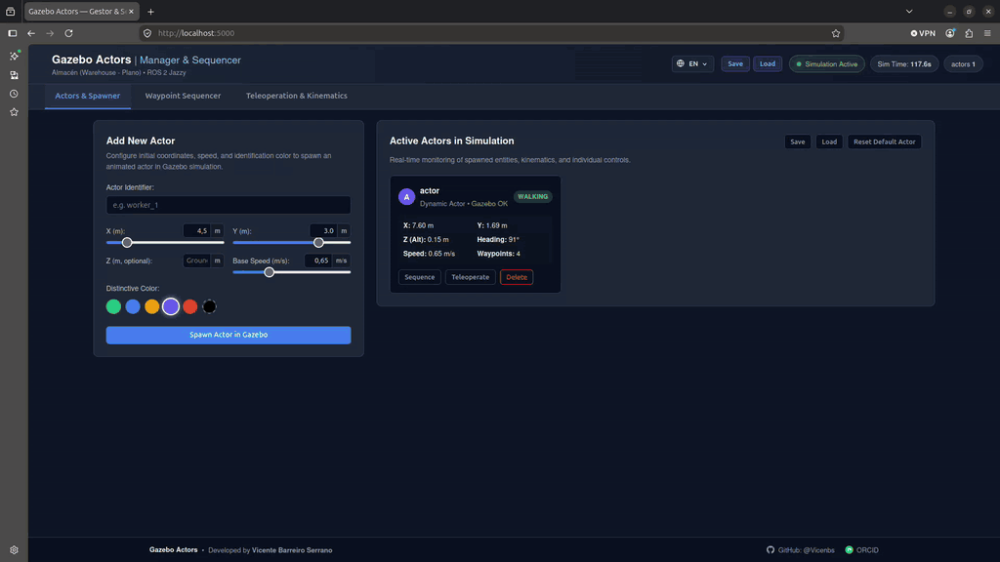
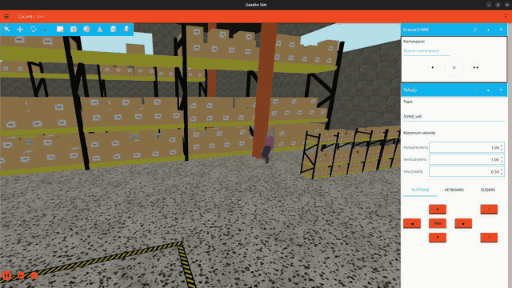

# Gazebo Actors

Universal ROS 2 and Gazebo Sim package for dynamic actor management, rigid physical collision synchronization, skeletal animation coupling, and interactive waypoint sequencing across arbitrary simulation environments.

[](https://docs.ros.org/en/jazzy/)
[](https://gazebosim.org/)
[](https://opensource.org/licenses/Apache-2.0)
[](https://en.cppreference.com/w/cpp/17)
[](https://www.python.org/)

<p align="center">
  
  <br>
  <em>Interactive 2D waypoint sequencer with real-time actor co-simulation in Gazebo Sim.</em>
</p>

---

## Overview

In robot simulation, standard Gazebo animated actors (`<actor>`) are purely visual entities lacking physical collision shapes. Consequently, mobile robots pass through them, and perception sensors (such as 2D/3D LiDAR, depth cameras, and ultrasonic sensors) cannot detect them as physical obstacles.

`gazebo_actors` addresses this limitation for any Gazebo world (planar floors, uneven outdoor terrains, sloped landscapes, agricultural fields, or industrial warehouses) through a tightly coupled hybrid architecture:

1. **Physical Collision Body (`{name}_collision`)**: A rigid kinematic capsule model ($r = 0.25\text{ m}$, $h = 1.20\text{ m}$) that generates realistic contacts in Gazebo physics engines (Bullet Featherstone / DART).
2. **Animated Skeletal Actor (`{name}`)**: A Collada 3D mesh with real-time dynamic switching between skeletal animations (`walk`, `stand`/`idle`, `talk`, `dance`).
3. **Native C++ System Plugin (`GazeboActorFollower`)**: A Gazebo Sim system plugin executing at simulation step frequency within the `EntityComponentManager` (ECM), tightly locking the visual actor's 3D pose, trajectory, ground elevation, and animation clip to the collider.
4. **Multi-Actor Manager & Sequencer (`actor_manager`)**: A ROS 2 node providing kinematic state machines, TF broadcasting, automatic entity cleanup upon shutdown, and scenario configuration persistence.
5. **Embedded Web Dashboard & REST API**: An integrated graphical dashboard (Canvas 2D + REST API) operating at port `5000`, fully responsive across desktop, tablet, and mobile displays with multi-language localization.

---

## System Architecture

```
 ┌────────────────────────────────────────────────────────────────────────┐
 │                   EMBEDDED WEB DASHBOARD (Port 5000)                   │
 │  - Actor Management: Spawn, Edit, Remove, Color customization          │
 │  - 2D Canvas Sequencer: Click-to-Waypoint, Modes (Loop/Ping-Pong/Once) │
 │  - Manual 3D Teleoperation: D-Pad, WASD + QE (Vertical clearance)      │
 │  - Scenario Persistence: Save/Load JSON configurations & Server presets│
 │  - Internationalization (i18n): 6 languages (EN, ES, DE, FR, PT, IT)   │
 └───────────────────────────────────┬────────────────────────────────────┘
                                     │ HTTP REST API / Polling (5 Hz)
                                     ▼
 ┌────────────────────────────────────────────────────────────────────────┐
 │                     ROS 2 NODE: actor_manager                          │
 │  - State Machine per Actor: NAVIGATING <-> WAITING <-> PAUSED <-> MANUAL│
 │  - 3D Terrain Follower & Kinematic Smoothing                           │
 │  - Automatic Clean Shutdown (Removes Gazebo entities on exit)          │
 │  - Scenario Importer/Exporter (JSON & YAML)                            │
 │  - Broadcasts /{name}/pose, /{name}/odom, and map -> {name} TF         │
 └─────────────┬───────────────────────────────────────────┬──────────────┘
               │ Dynamic Spawning:                         │ 20 Hz Kinematic Sync:
               │ /world/{world}/create                     │ gz.transport / SetEntityPose
               ▼                                           ▼
 ┌───────────────────────────┐               ┌───────────────────────────┐
 │       {name}_actor        │               │     {name}_collision      │
 │   (Visual Collada Mesh)   │               │ (Rigid Kinematic Capsule) │
 └─────────────▲─────────────┘               └─────────────┬─────────────┘
               │                                           │
               │         ECM System Hook                     │
               └───────── libGazeboActorFollower.so ───────┘
                          - 3D Coordinate Locking
                          - Dynamic Walk / Idle / Gesture Playback
                          - Ground-Aligned Vertical Clearance
```

---

## Key Features

* **Rigid Physical Collisions**: Spawns physical capsule colliders alongside visual actors, enabling realistic collisions with mobile robots, sensor perception (LiDAR point clouds, depth images), and obstacle avoidance testing.
* **Universal World Compatibility**: Auto-detects the running Gazebo world and terrain geometry. Supports flat planes, sloped terrain, and complex meshes.
* **Smooth 3D Kinematics & Vertical Regulation**: Real-time height adaptation with manual elevation adjustment (`Q` to lower, `E` to raise), maintaining constant ground clearance without vibration or bounce.
* **Multi-Gesture Skeletal Animation**: Dynamically switches animation clips (`walk`, `stand`/`idle`, `talk`, `dance`) during continuous patrol, waypoint pauses, or manual teleoperation.
* **Automatic Clean Shutdown**: Intercepts `SIGINT`, `SIGTERM`, and launch file termination to remove all spawned actors and collision bodies from Gazebo Sim, preventing orphaned physics models.
* **Scenario Persistence & Presets**: Export and import entire multi-actor scenarios (identities, initial poses, velocities, colors, modes, and full waypoint sequences) via JSON/YAML files, web dialogs, or launch parameters.
* **Standard ROS 2 Interfaces**: Publishes `PoseStamped`, `Odometry`, and broadcast TF frames (`map -> {name}`) for every actor. Subscribes to `human/cmd_vel` and `actor/cmd_vel` for teleoperation.
* **Embedded Responsive Web Dashboard**: Accessible at `http://localhost:5000` with zero external frontend dependencies. Features a 2D canvas map, real-time telemetry cards, interactive modal dialogs, touch/keyboard controls, and full multi-language localization (English, Spanish, German, French, Portuguese, Italian) with automatic locale detection.

---

## Installation

### Prerequisites

* **Operating System**: Ubuntu 24.04 LTS (or compatible Linux distribution)
* **ROS 2**: Jazzy Jalisco (desktop or base installation)
* **Gazebo Sim**: Harmonic (`gz-sim8`, `gz-transport13`, `gz-msgs10`)
* **Python Dependencies**: `python3-flask`, `python3-yaml`

```bash
sudo apt update
sudo apt install -y \
  ros-jazzy-ros-gz-interfaces \
  ros-jazzy-ros-gz-bridge \
  ros-jazzy-tf2-ros \
  python3-flask \
  python3-yaml
```

### Build Instructions

Clone or place `gazebo_actors` inside your ROS 2 workspace:

```bash
cd ~/ros2_ws/src
# (Place or clone gazebo_actors here)

cd ~/ros2_ws
source /opt/ros/jazzy/setup.bash

# Build the package
colcon build --symlink-install --packages-select gazebo_actors

# Source workspace environment
source install/setup.bash
```

---

## Usage

### 1. Launching alongside an Existing Gazebo World

If an existing Gazebo Sim instance is already running (e.g. warehouse, outdoor field, uneven terrain, or custom world):

```bash
ros2 launch gazebo_actors actor_manager.launch.py
```

By default, the node:
* Auto-detects the active Gazebo world (`world_name:=auto`).
* Detects terrain elevation properties (`terrain_type:=auto`).
* Opens the Web Dashboard at `http://localhost:5000`.

### 2. Launching with a Predefined Scenario Configuration

You can launch a pre-configured multi-actor scenario directly from the command line using the `scenario_file` argument:

```bash
# Load a built-in package preset by name
ros2 launch gazebo_actors actor_manager.launch.py scenario_file:=default_scenario.json

# Load the multi-worker patrol preset
ros2 launch gazebo_actors actor_manager.launch.py scenario_file:=patrol_scenario.json

# Load a custom scenario from an absolute or relative path
ros2 launch gazebo_actors actor_manager.launch.py scenario_file:=/path/to/my_scenario.json
```

### 3. Standalone Flat Simulation (Gazebo Sim + Dashboard)

To start a complete standalone test environment with an empty flat world, simulation clock bridge, and the web interface:

```bash
ros2 launch gazebo_actors flat_simulation.launch.py
```

### 4. Launch Arguments

| Argument | Type | Default | Description |
| :--- | :--- | :--- | :--- |
| `world_name` | string | `auto` | Target Gazebo world (`auto` queries active worlds dynamically). |
| `scenario_file` | string | `""` | File path or preset name (`.json` or `.yaml`) for pre-configured scenarios. |
| `terrain_type` | string | `auto` | Terrain model: `auto` (auto-adaptive), `flat`, or `slope`. |
| `slope_deg` | double | `0.0` | Reference slope angle in degrees (auto-detected when `terrain_type` is `auto`). |
| `spawn_initial_actor` | bool | `true` | Spawns a default worker if no scenario file is loaded. |
| `default_actor_name` | string | `human_worker` | Name of the fallback default actor. |
| `default_actor_x` | double | `4.5` | Initial X position of fallback actor. |
| `default_actor_y` | double | `0.0` | Initial Y position of fallback actor. |
| `web_port` | int | `5000` | Port for the embedded Web Dashboard and REST API. |
| `x_min` / `x_max` | double | `-15.0` / `30.0` | Canvas coordinate boundaries along X (meters). |
| `y_min` / `y_max` | double | `-15.0` / `15.0` | Canvas coordinate boundaries along Y (meters). |
| `environment_name` | string | `Gazebo Simulation` | Descriptive label displayed on the Web Dashboard. |
| `robot_odom_topic` | string | `odom` | Odometry topic of the simulated robot for distance computation. |
| `publish_rate_hz` | double | `20.0` | Pose synchronization and TF broadcast frequency (Hz). |
| `sync_gazebo` | bool | `true` | Enables direct entity spawning and pose synchronization in Gazebo Sim. |
| `use_sim_time` | bool | `true` | Synchronizes with the `/clock` topic. |

---

## Web Dashboard

Once launched, navigate to `http://localhost:5000` in any web browser.

<p align="center">
  
  <br>
  <em>Embedded Web Dashboard: Spawner interface, real-time telemetry cards, and multi-language controls.</em>
</p>

### Actor Management
* **Dynamic Spawning**: Form to spawn new actors with custom names, initial 3D positions, speed, and shirt/marker colors.
* **Live Telemetry Cards**: Displays real-time coordinates $(X, Y, Z)$, yaw angle, linear velocity, navigation state, and proximity to the robot.
* **Scenario Controls**:
  * **Save Configuration**: Exports the current scenario to a downloadable JSON file or saves it as a named preset on the server.
  * **Load Configuration**: Imports a JSON configuration from the local disk or selects from server-side presets.
  * **Clean Respawn / Delete**: Reset actors to their origins or remove them completely from the simulation.

### 2D Waypoint Sequencer
* **Interactive Canvas**: Click anywhere on the map canvas to place waypoints.
* **Sequential Configuration**: Set dwell times (`wait_time`), waypoint-specific speeds, and trigger gestures (`idle`, `talk`, `dance`).
* **Execution Modes**:
  * `Loop`: Continuously cycles through the route.
  * `Ping-Pong`: Navigates forward and backward along the sequence.
  * `Once`: Executes the sequence once and halts at the final waypoint.
* **Playback Controls**: Start, Pause, Stop, and Step forward through waypoints.

### Manual Teleoperation
* **Directional Pad & Keyboard**: WASD or arrow keys for planar movement; spacebar for emergency stop.
* **Vertical Clearance Regulation**: Keys `Q` (lower) and `E` (raise) adjust actor height relative to the ground surface.
* **Instant Gesture Trigger**: Buttons to command the actor to talk, dance, or return to standard idle pose.

### Internationalization (i18n)
* **6 Selectable Languages**: Complete interface localization across all controls, tabs, telemetry cards, sequencer tables, modal dialogs, and notifications: English (`EN`), Spanish (`ES`), German (`DE`), French (`FR`), Portuguese (`PT`), and Italian (`IT`).
* **Auto-Detection & Persistence**: Automatically detects system locale from the browser (`navigator.languages`), supports instant live switching via the header dropdown, and preserves preferences in `localStorage`.

---

## Scenario File Format

Scenarios are stored in clean JSON (or YAML) format. Example of a two-actor configuration:

```json
{
  "version": "1.0",
  "name": "Warehouse Inspection Scenario",
  "description": "Two workers conducting inspection patrols with dwell times and gestures.",
  "actors_count": 2,
  "actors": [
    {
      "name": "inspector_a",
      "display_name": "Inspector A",
      "color": "#10b981",
      "speed": 0.65,
      "mode": "loop",
      "teleop_idle_action": "talk",
      "x": 4.5,
      "y": 0.0,
      "z": 0.0,
      "manual_z_offset": 0.0,
      "yaw": 0.0,
      "waypoints": [
        {"id": 1, "x": 4.5, "y": 0.0, "wait_time": 3.0, "speed": 0.65, "action": "talk", "label": "Start"},
        {"id": 2, "x": 10.5, "y": 0.0, "wait_time": 4.0, "speed": 0.65, "action": "dance", "label": "Check Area"},
        {"id": 3, "x": 16.0, "y": 0.0, "wait_time": 2.0, "speed": 0.65, "action": "idle", "label": "End"}
      ]
    },
    {
      "name": "supervisor",
      "display_name": "Supervisor",
      "color": "#3b82f6",
      "speed": 0.60,
      "mode": "ping_pong",
      "teleop_idle_action": "idle",
      "x": 6.0,
      "y": 3.0,
      "z": 0.0,
      "manual_z_offset": 0.0,
      "yaw": 0.0,
      "waypoints": [
        {"id": 1, "x": 6.0, "y": 3.0, "wait_time": 2.0, "speed": 0.60, "action": "idle", "label": "Aisle Entry"},
        {"id": 2, "x": 13.0, "y": 3.0, "wait_time": 5.0, "speed": 0.60, "action": "talk", "label": "Aisle Review"}
      ]
    }
  ]
}
```

Pre-configured presets are located in the [`config/`](config/) directory:
* [`default_scenario.json`](config/default_scenario.json): Standard dual-worker scenario.
* [`patrol_scenario.json`](config/patrol_scenario.json): Three-worker inspection and patrol setup with coordinated routes.

---

## ROS 2 Interface

### Published Topics

For each active actor `{name}`:
* **`/{name}/pose`** (`geometry_msgs/msg/PoseStamped`): 3D global pose referenced to the `map` frame.
* **`/{name}/odom`** (`nav_msgs/msg/Odometry`): Position, orientation, linear velocity, and angular velocity.
* **`tf`**: Dynamic coordinate transform `map -> {name}`.

### Subscribed Topics

* **`human/cmd_vel`** / **`actor/cmd_vel`** (`geometry_msgs/msg/Twist`): Manual velocity commands.
* **`/{robot_odom_topic}`** (`nav_msgs/msg/Odometry`): Odometry of the main robot for proximity tracking.
* **`/clock`** (`rosgraph_msgs/msg/Clock`): Simulation clock.

### REST API Endpoints

The embedded Flask server exposes the following endpoints:

| Method | Endpoint | Description |
| :--- | :--- | :--- |
| `GET` | `/api/status` | Returns telemetry for all actors, robot pose, and simulation time. |
| `GET` | `/api/terrain` | Returns workspace bounds and terrain profile parameters. |
| `POST` | `/api/actors` | Spawns a new actor dynamically. |
| `DELETE` | `/api/actors/<name>` | Deletes an actor and its collider from the simulation. |
| `POST` | `/api/actors/<name>/waypoints` | Adds a waypoint to the actor's route. |
| `DELETE` | `/api/actors/<name>/waypoints/<id>` | Removes a specific waypoint. |
| `POST` | `/api/actors/<name>/sequence` | Controls sequence execution (`start`, `pause`, `stop`, `step`, `set_mode`). |
| `POST` | `/api/actors/<name>/teleop` | Sends directional velocity and gesture commands. |
| `POST` | `/api/actors/<name>/adjust_z` | Regulates vertical clearance offset relative to terrain. |
| `GET` | `/api/config/export` | Exports the full scenario configuration as JSON (`?download=true` for file attachment). |
| `POST` | `/api/config/import` | Imports a scenario, replacing current actors with configured entities. |
| `GET` | `/api/config/presets` | Lists available scenario presets stored on the server. |
| `POST` | `/api/config/presets/load` | Loads a preset file by name. |
| `POST` | `/api/config/presets/save` | Saves the active setup as a preset file in the package repository. |

---

## Gazebo System Plugin: `GazeboActorFollower`

The C++ system plugin (`libGazeboActorFollower.so`) can also be embedded directly inside any custom SDF model or world description:

```xml
<plugin filename="libGazeboActorFollower.so" name="gazebo_actors::ActorFollower">
  <actor_name>human_worker</actor_name>
  <target>human_worker_collision</target>
  <animation_walk>walk</animation_walk>
  <animation_stand>stand</animation_stand>
  <z_offset>0.86</z_offset>
  <animation_x_vel>2.0</animation_x_vel>
</plugin>
```

<p align="center">
  
  <br>
  <em>Physical collision capsule body tightly locked to the animated skeletal mesh during real-time simulation.</em>
</p>

---

## Citation

If you use this package in your research, simulation benchmarks, or publications, please cite it as follows:

```bibtex
@software{gazebo_actors2026,
  author       = {Barreiro Serrano, Vicente},
  title        = {{gazebo\_actors: Dynamic Actor Management, Physical Collision Coupling, and Waypoint Sequencing for Gazebo Sim and ROS 2}},
  year         = {2026},
  publisher    = {GitHub},
  howpublished = {\url{https://github.com/Vicenbs/gazebo_actors}},
  version      = {1.0.0}
}
```

Alternatively, use the **Cite this repository** button provided by GitHub on the repository sidebar (powered by [`CITATION.cff`](CITATION.cff)).

---

## License

This project is licensed under the **Apache License 2.0** - see the [LICENSE](LICENSE) file for details.
